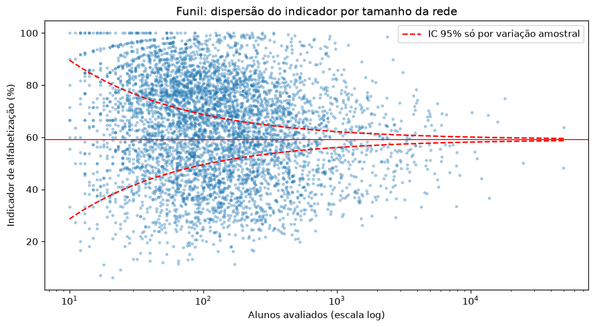
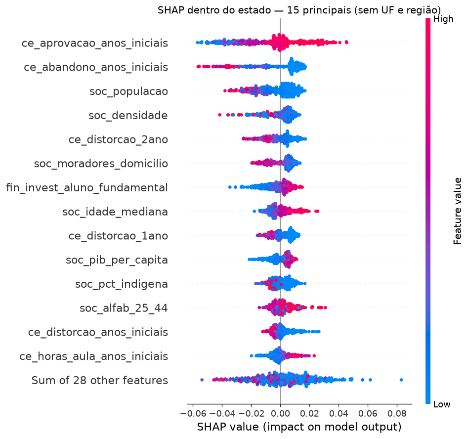
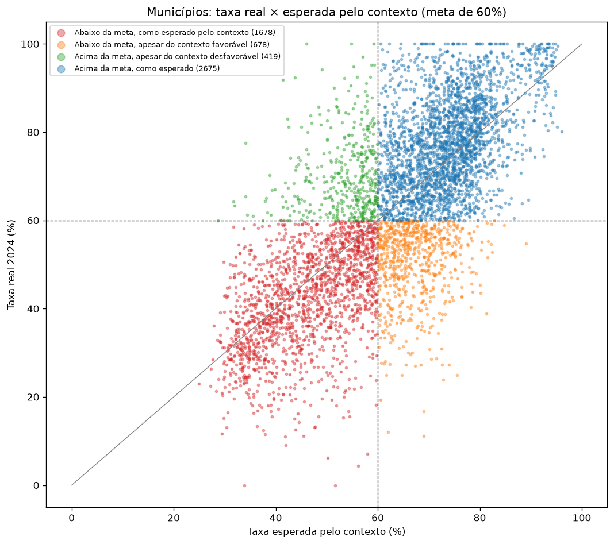

# Previsão de Alfabetização Municipal — Tech Challenge Fase 3

Modelo de machine learning que estima a taxa de alfabetização ao fim do 2º ano do ensino fundamental nos municípios brasileiros (Indicador Criança Alfabetizada, rede municipal, 2024) a partir de dados de contexto educacional, socioeconômico e de financiamento — e identifica municípios em risco de não atingir a meta nacional de 60%.

## 1. Resumo executivo

- **Base:** 5.450 municípios (25 UFs), alvo de 2024 e features de 2022–2023 (precedência temporal garantida).
- **Desempenho no teste** (municípios nunca vistos no treino): o modelo captura **83% do sinal alcançável** com dados municipais, erra a taxa de alfabetização de um município em **7,0 p.p.** em média (baseline: 12,9 p.p.) e identifica municípios abaixo da meta com **AUC de 0,87**. As probabilidades são bem calibradas (erro médio de 0,6 p.p.).
- **Principal achado:** o **estado** em que o município está é o fator mais associado à alfabetização (efeito de até ±20 p.p.). Dentro de cada estado, fluxo escolar, porte, vulnerabilidade domiciliar, investimento por aluno e escolaridade dos pais deslocam a taxa em 2 a 5 p.p. cada.
- **Aplicação:** ranking de risco com a taxa esperada pelo contexto para cada município e lista dos que mais se distanciam do esperado — candidatos a estudo de boas práticas ou a apoio prioritário ([`reports/ranking_municipios.csv`](reports/ranking_municipios.csv)).

## 2. Problema e perguntas de negócio

O Indicador Criança Alfabetizada (INEP/MEC) mede o percentual de alunos alfabetizados ao fim do 2º ano, a partir de avaliações estaduais alinhadas à escala do Saeb. A meta nacional para 2024 é de 60%.

1. **Quais fatores estão associados à alfabetização?**
2. **Quais municípios estão em risco de não atingir a meta?**

## 3. Dados

| Família | Fonte | Variáveis | Ano |
|---|---|---|---|
| Alvo e peso | INEP/MEC — Indicador Criança Alfabetizada (camada Silver da Fase 2) | % de alfabetizados na rede municipal; nº de alunos avaliados | 2024 |
| `ce_` Censo Escolar (27) | INEP — Indicadores Educacionais, planilhas oficiais | Alunos por turma, horas-aula, adequação da formação docente, regularidade docente, distorção idade-série, rendimento | 2023 |
| `soc_` Socioeconômico (10) | IBGE — Censo 2022 e PIB dos Municípios (via Base dos Dados) | População, densidade, moradores/domicílio, alfabetização de 25–44 anos, idade mediana, % indígena e quilombola, esgotamento sanitário, PIB per capita | 2022–2023 |
| `fin_` Financiamento (5) | FNDE/SIOPE (via Base dos Dados) | Investimento por aluno (básica, fundamental, pré-escola), despesa com professores por aluno, % do orçamento em educação | 2023 |
| `ter_` Território (2) | Código IBGE | UF e região | — |

- **População:** municípios com resultado da rede municipal em 2024. Roraima não tem resultado da rede municipal na fonte; o Distrito Federal não tem rede municipal.
- **Unidade de análise:** município. As features do Censo Escolar referem-se à **dependência municipal** — a mesma rede do alvo.
- **Dicionário de dados:** [`reports/dicionario_base_modelagem.csv`](reports/dicionario_base_modelagem.csv).

## 4. Qualidade dos dados

Validações que alteraram a base ([notebook 01](notebooks/01_validacao_fontes.ipynb)):

- **220 municípios recuperados.** A camada Gold herdada da Fase 2 continha 5.232 municípios; a Silver tinha resultado para 5.452. Os ausentes (~3,5% dos alunos) concentravam-se em poucos estados — Acre inteiro, Amazonas, Santa Catarina, Rio Grande do Norte, Rio Grande do Sul — e tinham desempenho mais baixo. Excluí-los enviesaria o modelo para cima. A base passou a ser construída a partir da Silver.
- **Fonte de terceiros descartada.** A tabela de indicadores educacionais da Base dos Dados tem colunas deslocadas em 2023 — grupos que deveriam somar 100% somam ~500% ou ~1%. Os indicadores passaram a ser lidos das planilhas oficiais do INEP, que respeitam todas as identidades.
- **Rede confirmada empiricamente.** O leitor das planilhas oficiais reproduz em 100% as 37 colunas do enriquecimento original quando usa a linha *localização Total / dependência Municipal*.
- **PIB per capita:** PIB 2023 ÷ população 2023 do IBGE (reproduz o enriquecimento original em 100%), estendido a todos os municípios.
- **Silver:** linhas multiplicadas por join, com valores idênticos — deduplicadas na extração.

## 5. Análise exploratória

Achados que orientaram a modelagem ([notebook 02](notebooks/02_eda_modelagem.ipynb)):

- **A unidade importa:** 56,8% dos municípios estão acima de 60%, mas só 46,2% dos alunos — os municípios grandes alfabetizam menos. A média ponderada por alunos (58,7%) é próxima da taxa nacional oficial.
- **Redes pequenas são ruidosas:** 25% dos municípios têm até 55 alunos avaliados (erro-padrão de ~6,5 p.p.). O treino é ponderado pelo número de alunos.
- **A UF supera a região:** Bahia (35,9%) e Ceará (85,3%) estão na mesma região.
- **Colinearidade:** 16 pares de features com |ρ| ≥ 0,85 → 13 removidas, restando **44 features**.

<p align="center"></p>

## 6. Metodologia

**Enquadramento.** O brief pede prever se um aluno será alfabetizado. Como as features são municipais, cada município é expandido em dois registros — alfabetizados (rótulo 1) e não alfabetizados (rótulo 0) — com pesos iguais às contagens de alunos. Um classificador ponderado nesses registros modela a probabilidade de um aluno do município ser alfabetizado; essa probabilidade é a taxa esperada do município.

**Teto alcançável.** Nenhuma feature municipal distingue dois alunos do mesmo município. O AUC de um "oráculo" que conhece a taxa real de cada município é o máximo possível (~0,69); o desempenho é reportado também como **% do teto** = (AUC − 0,5) / (AUC do oráculo − 0,5).

**Validação.** 20% dos municípios separados como teste, intocados até a avaliação final. Nos 80% restantes, validação cruzada de 5 folds. Ambas as divisões são feitas no nível do município (antes da expansão) e estratificadas por UF.

**Pipelines** ([`src/modeling/pipelines.py`](src/modeling/pipelines.py)) — todo o pré-processamento é ajustado só nos dados de treino de cada fold:
- **Regressão logística (L2):** imputação pela mediana (com indicador de ausência para nulos estruturais, como turmas multietapa), log1p nas variáveis assimétricas, padronização, one-hot nas categóricas.
- **HistGradientBoosting:** nulos tratados nativamente, UF e região como categóricas nativas, sem early stopping interno (evita misturar registros do mesmo município entre treino e validação internos).
- **Baseline:** taxa média do treino para todos.

**Métricas** ([`src/evaluation/metrics.py`](src/evaluation/metrics.py)): AUC e log-loss no nível do aluno (ponderados), % do teto, erro absoluto médio da taxa municipal (MAE, ponderado por alunos) e AUC para identificar municípios abaixo de 60%.

## 7. Resultados

| Modelo | Validação cruzada — % do teto | Teste — % do teto | Teste — MAE (p.p.) | Teste — AUC de risco |
|---|---|---|---|---|
| Baseline | 0% | 0% | 12,9 | 0,50 |
| Regressão logística | 81,1% | 80,3% | 7,8 | 0,87 |
| **HistGradientBoosting** | **82,0% ± 1,5** | **82,9%** | **7,0** | **0,87** |

- **Modelo principal: HistGradientBoosting** — superior à logística em 4 de 5 folds no AUC e em todos os folds na log-loss e no MAE.
- **Generalização:** as métricas do teste ficam dentro de ±1 desvio-padrão da validação cruzada ([`reports/metricas_teste.json`](reports/metricas_teste.json)).
- **Robustez:** numa grade de 27 combinações de hiperparâmetros, a log-loss variou só de 0,6432 a 0,6435 — o desempenho não depende de ajuste fino.
- **Calibração:** erro médio de 0,6 p.p. entre taxa prevista e real nas previsões fora do fold.

**Ablações** — % do teto ao retreinar sem famílias de features ([notebook 03](notebooks/03_modelagem.ipynb)):

| Cenário | HGB | Logística |
|---|---|---|
| Todas as 44 features | 82% | 81% |
| Sem fluxo escolar | 80% | 79% |
| Sem território (UF, região) | 68% | 59% |
| Sem fluxo e sem território (contexto puro) | 52% | 43% |

O fluxo escolar (aprovação, abandono, distorção) — que poderia ser "desempenho passado disfarçado" — acrescenta pouco quando a UF está presente: as duas famílias se sobrepõem, e o fluxo funciona em boa parte como assinatura da política estadual.

## 8. Interpretabilidade

Duas técnicas complementares no teste ([notebook 04](notebooks/04_interpretabilidade.ipynb)):

- **Importância por permutação por grupo** — queda do % do teto ao embaralhar o grupo inteiro: território 51,7 pontos, fluxo escolar 14,7, socioeconômico 4,1; formação docente, financiamento e turmas/jornada ficam dentro do ruído (não acrescentam poder de previsão dado o estado e as demais features — o que não significa irrelevância causal).
- **SHAP** (PermutationExplainer; o TreeExplainer tem um bug conhecido com categóricas nativas do HistGradientBoosting).

<p align="center"></p>

**Dentro do estado** (o modelo usa a UF, então as demais contribuições comparam municípios do mesmo estado):

| Associado a taxa **maior** | Associado a taxa **menor** |
|---|---|
| Maior aprovação nos anos iniciais | Maior abandono e distorção idade-série |
| Maior investimento por aluno no fundamental | Maior população e densidade (municípios grandes e urbanos) |
| Maior alfabetização da geração dos pais (25–44 anos) | Mais moradores por domicílio; PIB per capita baixo |
| Mais horas-aula nos anos iniciais; maior idade mediana | Maior % de população indígena* |

\* Contexto de política educacional (ex.: alfabetização em português como segunda língua), não causa.

**Escala:** cada fator local desloca a previsão em 2–5 p.p.; o efeito estadual chega a ±20 p.p. Esse efeito mistura política educacional estadual e diferenças entre os instrumentos de avaliação de cada estado — não é possível separá-los com estes dados.

Todas as leituras são **associações no modelo, não efeitos causais**.

## 9. Aplicação: risco e municípios fora do esperado

Cada município recebe a **taxa esperada pelo contexto**, prevista por um modelo que nunca o viu (previsões fora do fold no treino; modelo final no teste). Comparada à taxa real e à meta de 60% ([notebook 05](notebooks/05_aplicacao.ipynb)):

<p align="center"></p>

| | Contexto desfavorável (esperada < 60%) | Contexto favorável (esperada ≥ 60%) |
|---|---|---|
| **Abaixo da meta** | 1.678 — apoio estrutural | 678 — investigar gestão local |
| **Acima da meta** | 419 — candidatos a boas práticas | 2.675 — como esperado |

O contexto medido deixa uma variação não explicada de 11,8 p.p. Somando-a ao ruído amostral, **273 municípios (5%) se distanciam mais de 2 desvios-padrão do esperado** — os extremos da distribuição, usados para priorizar investigação: 67 acima da meta apesar do contexto desfavorável, 106 abaixo apesar do contexto favorável e 41 abaixo da meta e bem abaixo até do esperado para um contexto desfavorável (prioridade de apoio).

A taxa esperada é um **escore para ordenar municípios**; as previsões são mais concentradas que a realidade, então não estimam quantos municípios ficarão abaixo da meta. Resíduos muito grandes podem refletir política local, mas também problemas de aplicação ou registro da avaliação.

## 10. Limitações e próximos passos

- **Cobertura:** apenas a rede municipal; Roraima e Distrito Federal fora (sem dados ou sem rede municipal).
- **Efeito estadual:** é o fator dominante e mistura política educacional e instrumento de avaliação.
- **Teto:** dados municipais não distinguem alunos dentro do município (AUC máximo ~0,69).
- **Choques não medidos:** ex.: as enchentes de 2024 no Rio Grande do Sul (44,3% de alfabetização, abaixo do resto do Sul).
- **Associação, não causalidade:** features correlacionadas dividem crédito; a leitura por grupo é a mais robusta.
- **Fontes não usadas:** IDHM municipal (Censo 2010, defasado), CadÚnico (indisponível no BigQuery) e PNAD (sem representatividade municipal).
- **Próximos passos:** incorporar o histórico de 2023 como preditor (indisponível para São Paulo); comparar as features do Censo Escolar da rede total vs. municipal; atualizar o modelo com o resultado de 2025.

## 11. Como reproduzir

**Requisitos:** Python 3.12, Google Cloud CLI e acesso ao projeto GCP do grupo (camadas Silver e Gold da Fase 2). As tabelas públicas da Base dos Dados são cobradas no projeto configurado; toda consulta passa por estimativa de custo (dry run) e teto de 1 GiB. A extração completa lê menos de 1 GiB, dentro da cota gratuita do BigQuery.

```bash
python3.12 -m venv .venv && source .venv/bin/activate
pip install -r requirements.txt
gcloud auth application-default login
export GCP_PROJECT_ID=grupo-pos-fase-2-alfabetizacao   # opcional; é o padrão

python -m src.data.extract --apenas-estimar   # custo estimado, nada é executado
python -m src.data.extract                    # fontes brutas -> data/raw/
python -m src.data.download_inep              # planilhas do INEP -> data/raw/inep_2023/
python -m src.data.inep_oficial               # leitura das planilhas
python -m src.data.build_features             # base de modelagem -> data/processed/
python -m src.modeling.train                  # modelo final + métricas no teste
python -m src.modeling.aplicacao              # ranking -> reports/ranking_municipios.csv
```

Se o download do INEP falhar por erro de certificado SSL (problema do servidor), baixe os 7 arquivos `.zip` listados em [`src/data/download_inep.py`](src/data/download_inep.py) pelo navegador, salve em `data/raw/inep_2023/` e rode o comando de novo (ele só extrai). Sem acesso ao BigQuery, os notebooks podem ser consultados com as saídas salvas.

## 12. Estrutura do repositório

```
src/
  data/          extração (BigQuery, INEP), validação das fontes e construção da base
  modeling/      configuração, divisão e expansão, pipelines, validação cruzada, treino final, aplicação
  evaluation/    métricas e interpretabilidade
notebooks/
  00_verificacao_base      verificação das tabelas Gold e Silver
  01_validacao_fontes      validação das fontes externas
  02_eda_modelagem         análise exploratória orientada à modelagem
  03_modelagem             comparação, ablações, ajuste, calibração, teste
  04_interpretabilidade    permutação e SHAP
  05_aplicacao             quadrantes de risco e destaques
reports/         dicionário de dados, métricas do teste, ranking de municípios
images/          figuras usadas neste README e nos notebooks
data/, models/   gerados localmente (fora do Git)
```

## 13. Equipe

| Integrante | Responsabilidade |
|---|---|
| Integrante 1 | Enriquecimento da camada Gold |
| Integrante 2 | Análise exploratória inicial |
| Integrante 3 | Modelagem: validação das fontes, construção da base de modelagem, pipeline de ML, avaliação, interpretabilidade e aplicação |
| Integrante 4 | Apresentação e ajustes finais de entrega |

## 14. Referências

- INEP — [Indicadores Educacionais](https://www.gov.br/inep/pt-br/acesso-a-informacao/dados-abertos/indicadores-educacionais)
- MEC — Compromisso Nacional Criança Alfabetizada e Indicador Criança Alfabetizada
- IBGE — Censo Demográfico 2022; PIB dos Municípios; estimativas de população
- FNDE — Sistema de Informações sobre Orçamentos Públicos em Educação (SIOPE)
- [Base dos Dados](https://basedosdados.org) — acesso às tabelas públicas no BigQuery
- [scikit-learn](https://scikit-learn.org) e [SHAP](https://github.com/shap/shap) (issue [#3436](https://github.com/shap/shap/issues/3436): TreeExplainer e categóricas do HistGradientBoosting)
